# CPT Analyser

**A complete cone penetration test (CPT) viewer and interpreter in a single HTML file.**
Double-click it and it runs in your browser – no installation, no licence key, no server, and your data never leaves your computer.

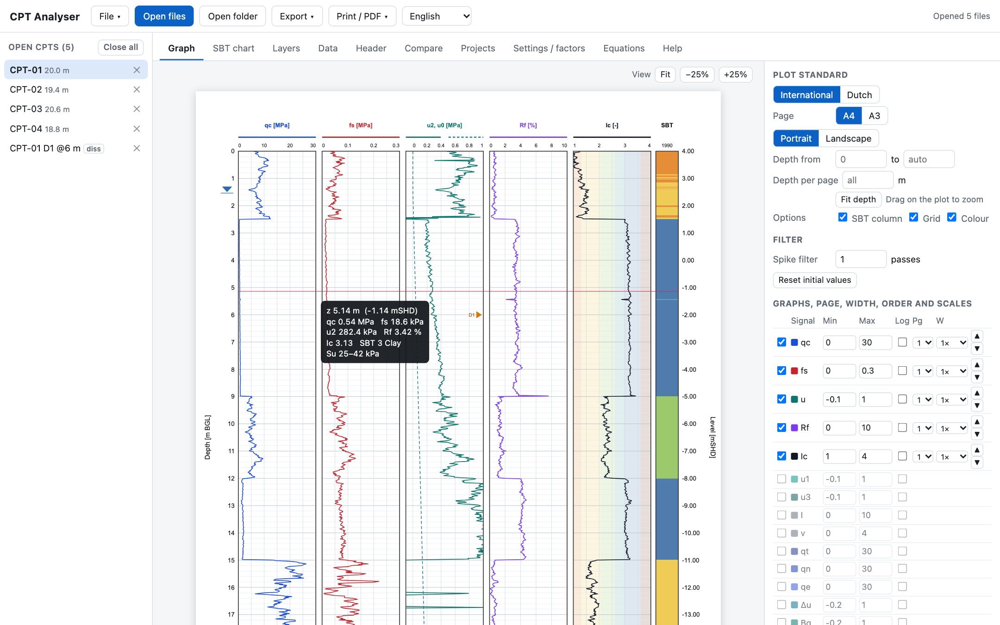

It covers the workflow of classic CPT presentation software: GEF and raw GME input, fs shift, inclination depth correction, spike filter, derived parameters, Robertson soil behaviour types, International and Dutch plot standards, dissipation tests, projects, new CPTs, exports and printing.

> All screenshots use synthetic demo data.

---

## Quick start

1. Download [`CPT_Analyser.html`](CPT_Analyser.html) (on GitHub: open the file → **Download raw file**).
2. Double-click it – it opens in Chrome, Edge, Safari or Firefox.
3. Click **Open files** (or **Open folder**, or drag files onto the page) and pick your `.GEF`, GME, Excel or CSV files.
4. Click a CPT in the list on the left.

Everything runs locally. The only network request is a one-time download of the [SheetJS](https://sheetjs.com/) Excel reader from cdnjs, and only when you open an `.xlsx` / `.xls` file.

---

## Features

### Input
| Format | Notes |
|---|---|
| **GEF CPT** (`.gef`) | qc, fs, u1 / u2 / u3, inclination (resultant or X/Y), time, corrected depth, header (project, location, cone, coordinates, ground level, water level, pre-drill, area ratio, sleeve distance). Any other columns (temperature, conductivity, Qst, Qt …) become extra graphs. |
| **GEF dissipation** (`GEF-DISS-Report`) | Time / pore pressure / qc; test depth and parent CPT from `#PARENT`. |
| **GME raw data** (`.0xx` header + `.1xx` data, e.g. `.0EF`/`.1EF`, `.001`/`.101`) | Converted with the calibration factors in the header: qc = ch1·cal1/10, fs = ch2·cal2/10, u = ch3·cal3/100 MPa. Verified against GEF files of the same tests. |
| **Excel** (`.xlsx`, `.xls`) | Header + Data sheets (CPTask-style exports) or any sheet with depth, qc, fs, u, I, Qst, Qt columns. |
| **CSV / TXT** | Columns by header name, or in the order length, qc, fs, u, I, Qst, Qt. |
| **Settings files** (`.cptset.json`) | Opened together with a CPT of the same name, they give that CPT its own settings. |

### Processing on open
- fs shift to cone depth (automatic for raw GME data – GEF files from Geomil rigs already contain shifted fs)
- Depth correction for inclination, pre-drill handling
- CPTask-style spike filter (number of passes, threshold), with **Reset initial values**
- Selectable pore-pressure filter location (u1 / u2 / u3)

### Derived parameters
Rf, u0, u/qc, qt, Δu, qe, γ (constant or Robertson & Cabal 2010), σv, σ′v, qn, Bq, Qt, Fr, Ic, **Robertson (1990) soil behaviour type**, Robertson (2009) Qtn and Ic,n, Dr (Baldi, NC and OC), φ′, Su (Nk min / max), equivalent SPT N60, penetration rate. All factors are editable. See the **Equations** tab for every formula.

### Plots
- **International standard** – choose graphs, order, min / max / log scale, **page (1–4) and width per graph**, and **depth per page** to split deep soundings over several pages
- **Dutch standard** – two graphs left, one reversed graph right
- SBT column, groundwater marker, level axis (e.g. mSHD / mNAP), title block, A4 / A3, portrait / landscape, colour or black-and-white
- Hover read-out, drag to zoom, double-click to reset, screen zoom ±25 %

| International | Dutch | Graphs on page 2 |
|---|---|---|
|  | 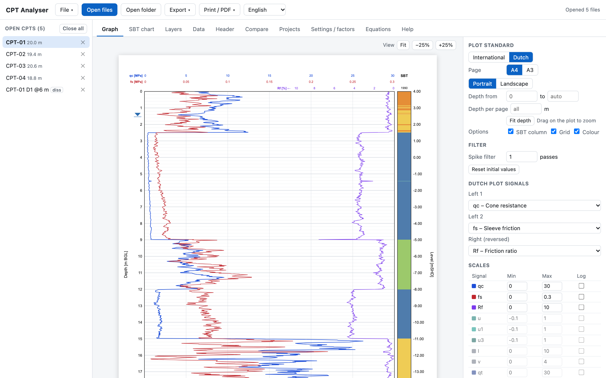 | 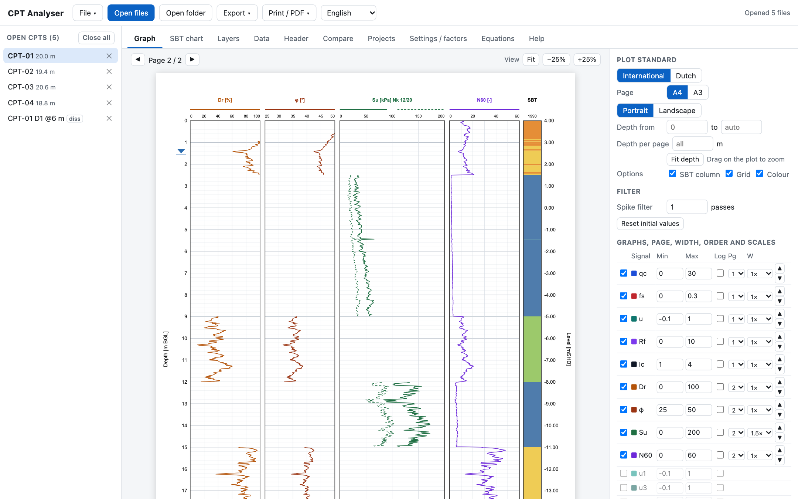 |

### Interpretation
| Robertson chart | Soil layers | Data table |
|---|---|---|
| 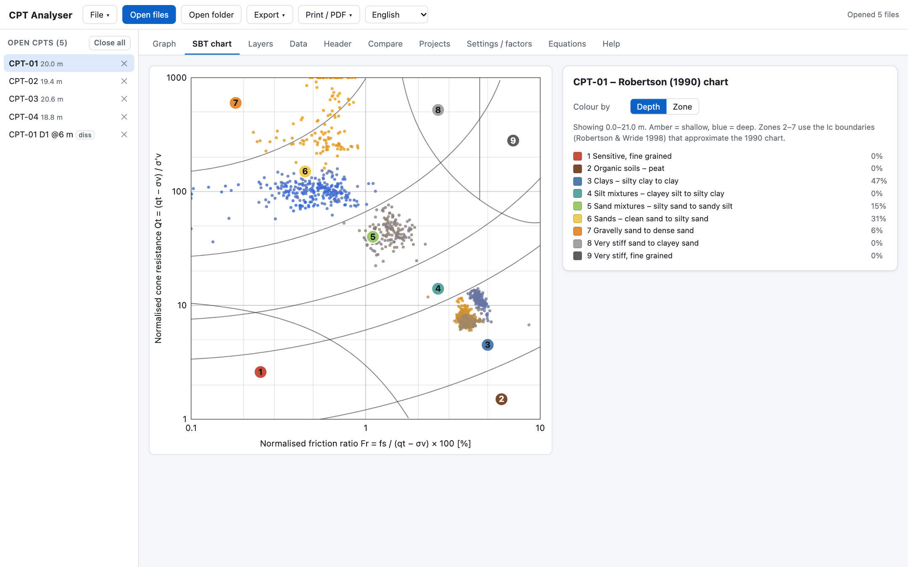 | 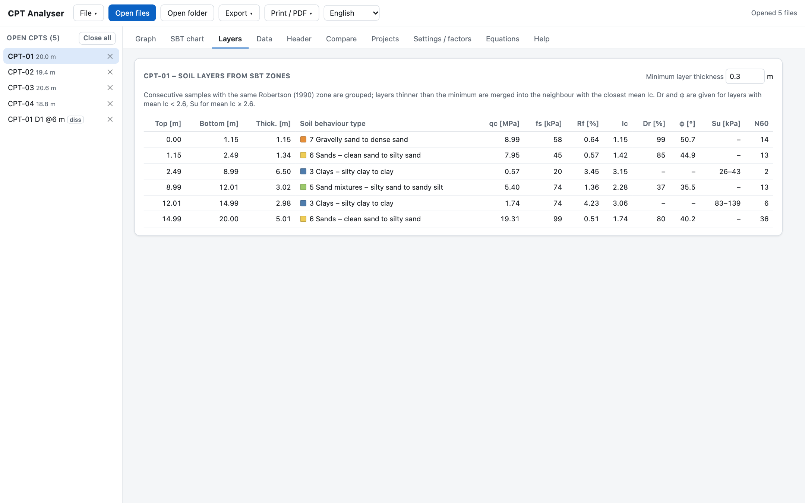 | 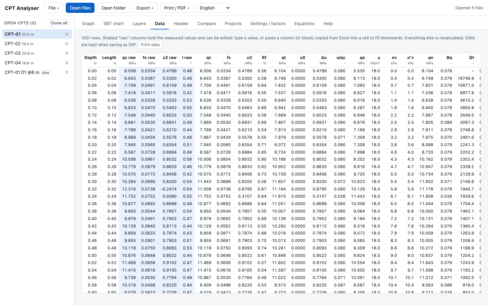 |

- **SBT chart** – every sample on the Qt–Fr chart, coloured by depth or zone
- **Layers** – automatic layering from SBT zones with a minimum thickness; average qc, fs, Rf, Ic, Dr, φ′, Su and N60 per layer
- **Data** – all raw and calculated values; raw readings can be corrected by typing or **pasted from Excel**; edits are kept when saving as GEF

### Dissipation tests
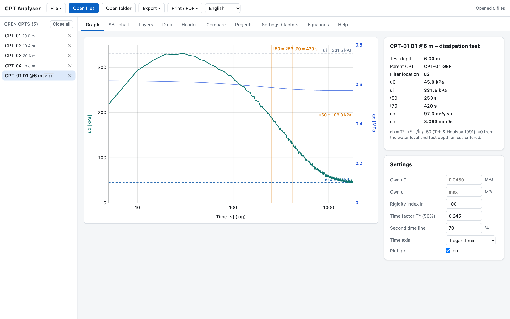

u against log / √ / linear time with qc, u0 (from water level and depth, or your own), ui, u50, t50, a second time line (e.g. t70) and the coefficient of consolidation ch (Teh & Houlsby 1991). Test depths are marked on the parent CPT's pore-pressure graph.

### Compare soundings
| Tile | Overlay |
|---|---|
| 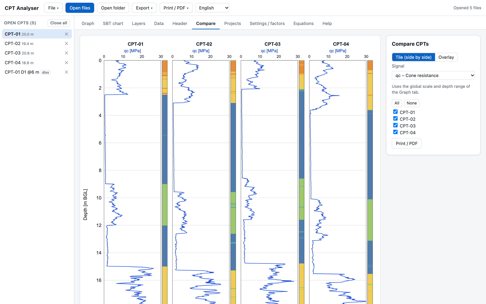 | 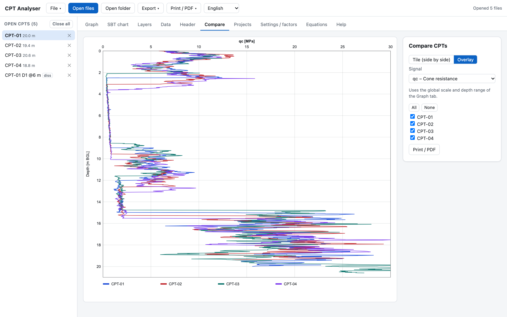 |

### Projects, new CPTs, header
| Projects | New CPT | Header / edit project |
|---|---|---|
| 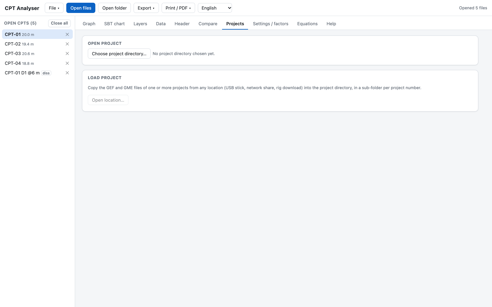 | 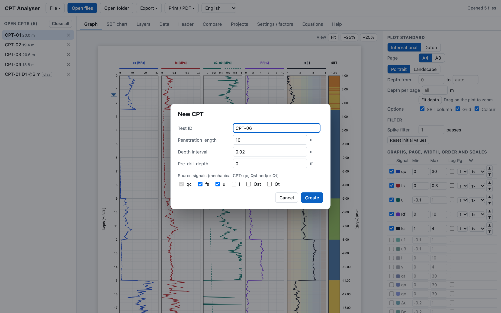 | 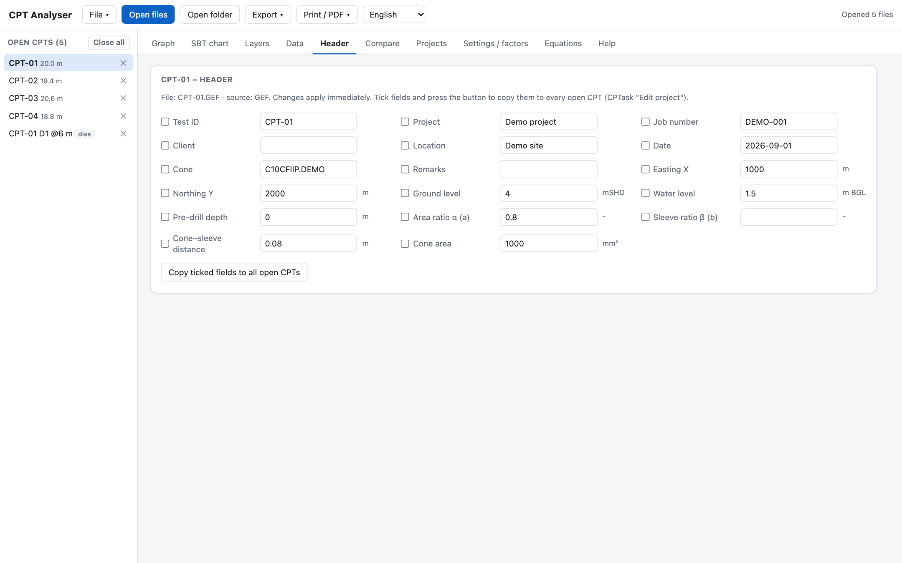 |

- **Open project** – lists every project number in a project directory with its GEF / GME counts and opens them in one click
- **Load project** – copies selected projects from any location into the project directory, one folder per project (Chrome / Edge; other browsers scan a folder instead)
- **New CPT** – set length, interval and signals (including mechanical Qst / Qt), then type or paste readings
- **Header** – edit header fields and copy ticked fields to all open CPTs

### Settings
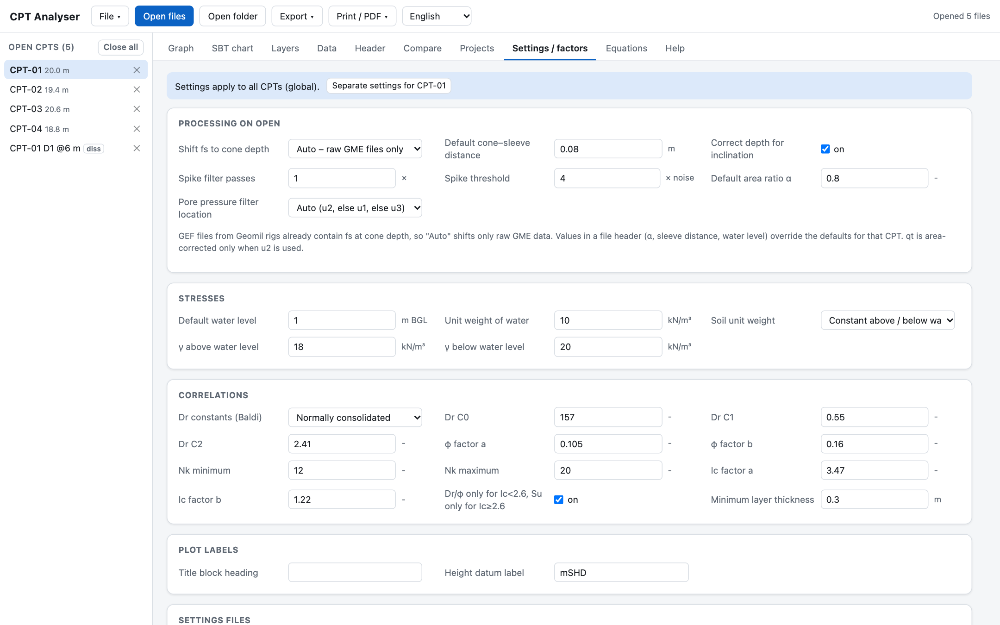

Global settings, or separate settings for one CPT. Save / load settings files, save as default (remembered in the browser), reset to factory defaults.

### Export and print
| Export menu | File menu |
|---|---|
| 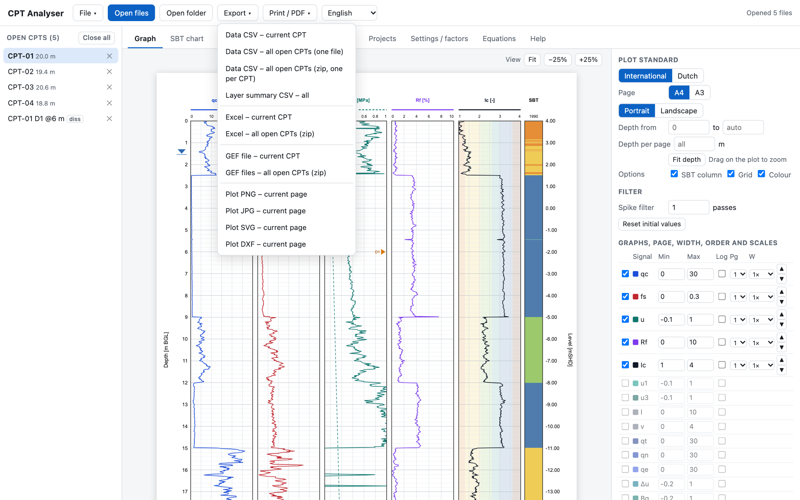 | 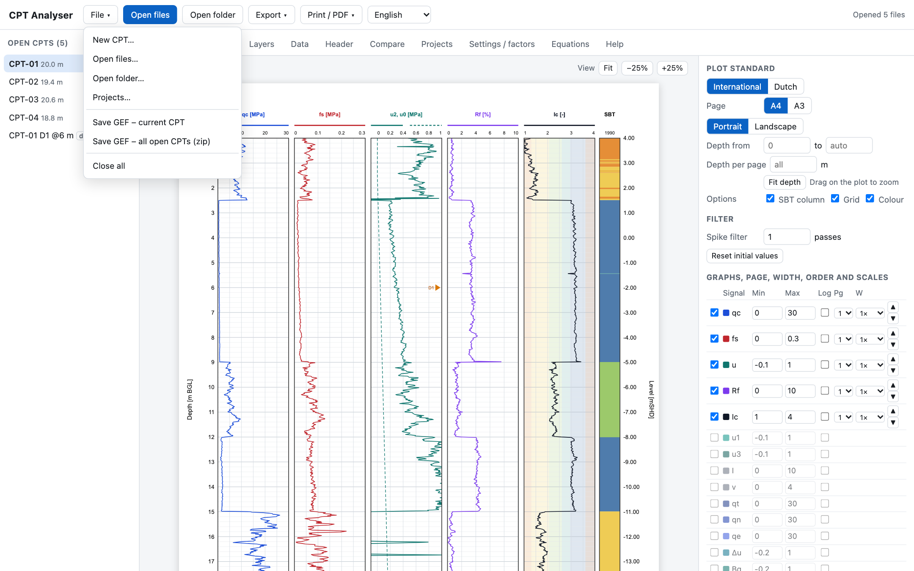 |

- **Data:** CSV (single, combined, or zip with one file per CPT), layer summary CSV
- **Excel:** `.xlsx` with Header, Data and Layers sheets – single or all (zip)
- **GEF:** single or all (zip); the original file layout is kept and only edited values change
- **Plot:** PNG, JPG, SVG, DXF of the current page
- **Print / PDF:** current CPT (all pages), all CPTs, the data table, or the compare view

### Languages
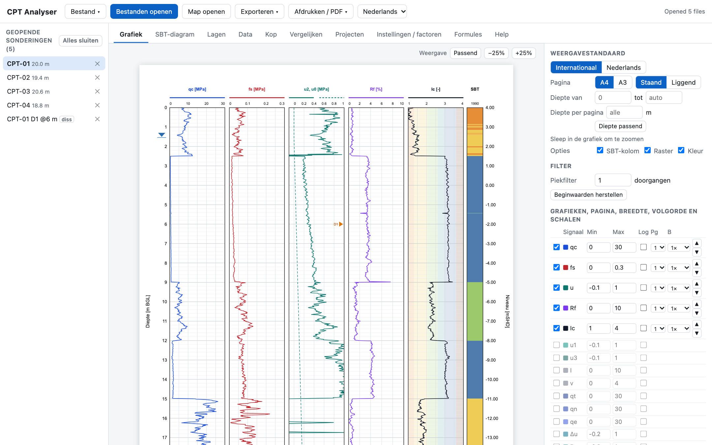

English, Nederlands and Deutsch built in. **Custom…** loads your own translation file (`English text = translation` per line, or JSON); a template with every term can be downloaded.

### Equations
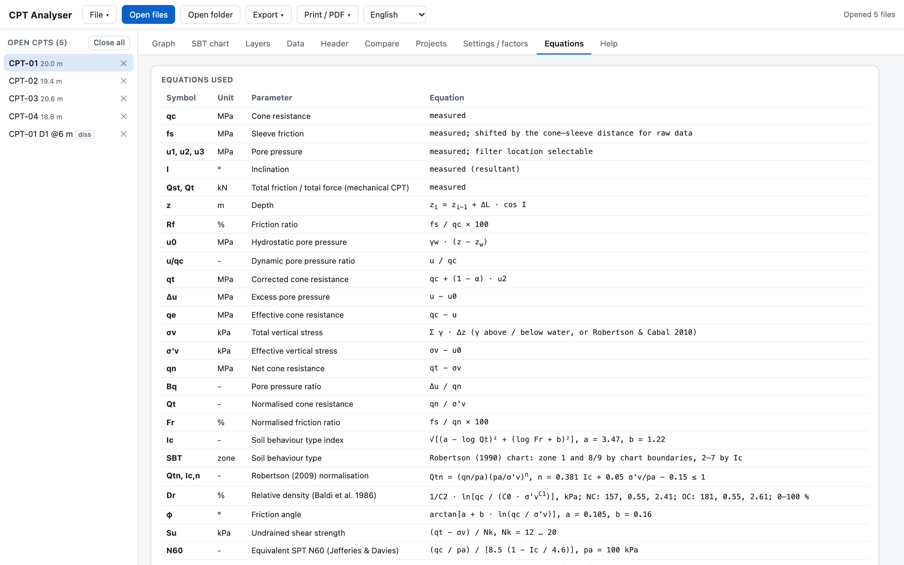

---

## Not included
- Soil classification from the Robertson Qt–Bq chart (only the Qt–Fr classification is given)
- GME dissipation files (`.Dxx`) – use GEF dissipation files
- Inclination from GME raw data (calibration differs per cone)

## Notes
- Correlations (Dr, φ′, Su, N60, γ) are indicative and should be checked against site-specific data.
- For GME subtraction cones (cone type S) the sleeve channel is corrected with an assumed sleeve area of 15 × the tip area.
- Not affiliated with Geomil Equipment B.V.; CPTask is their product. The equations and processing steps follow publicly documented methods.
